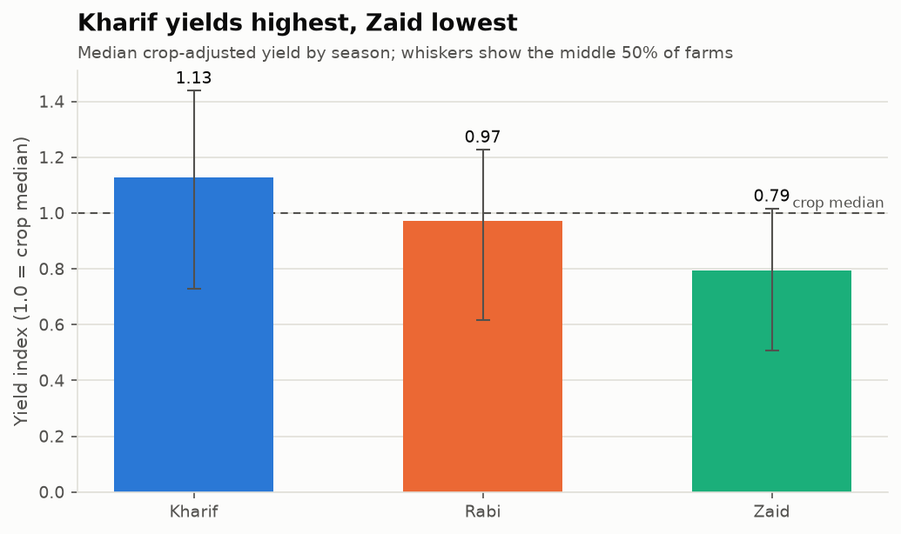
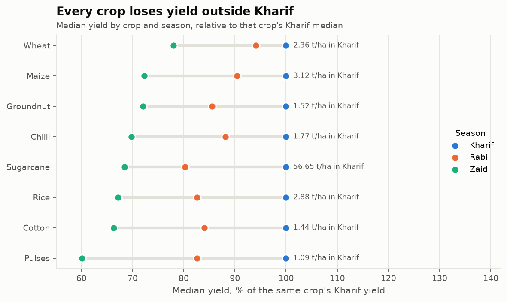
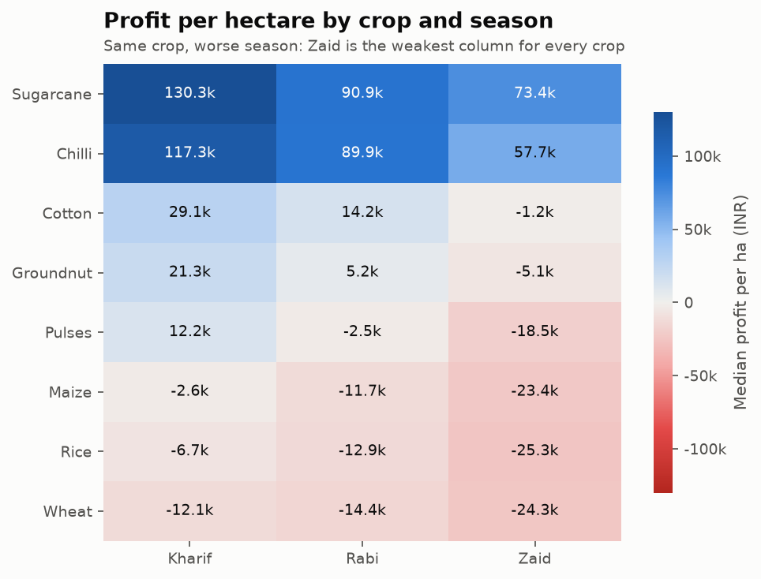
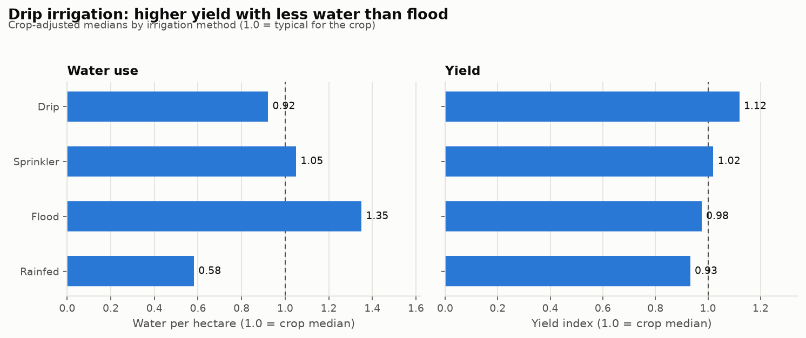
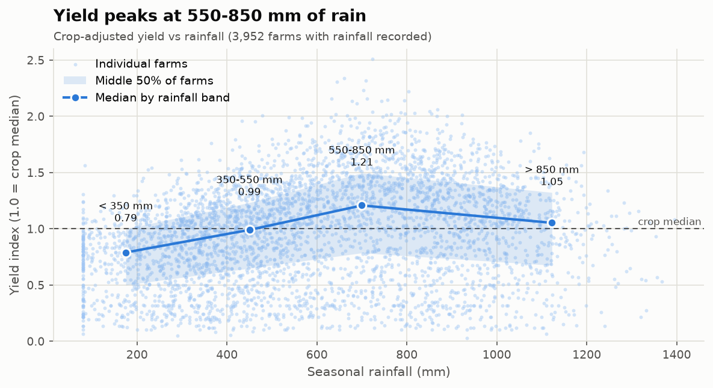
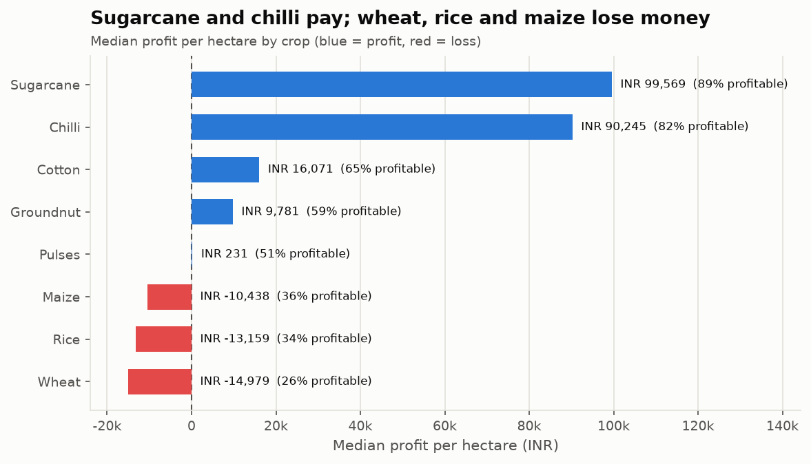
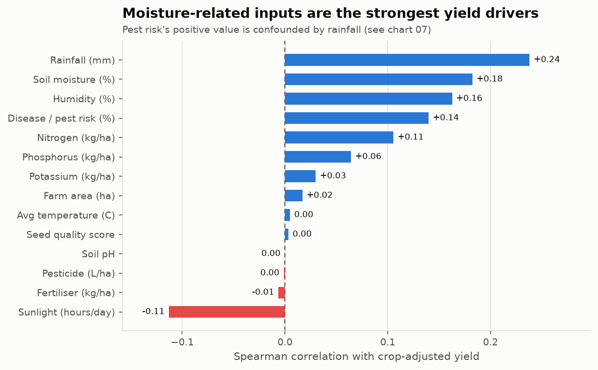

# 🌾 Seasonal Agriculture Performance Analysis

**VOIS AICTE Data Analytics Major Project**

An end-to-end data-analytics project that compares farm performance across India's three cropping seasons - **Kharif**, **Rabi** and **Zaid** - and works out which factors really drive yield and profit. It includes a reproducible analysis pipeline, a fully executed Jupyter notebook, an interactive Streamlit dashboard and an automated test suite.



---

## Table of contents

1. [Objective](#objective)
2. [Key findings](#key-findings)
3. [Dataset](#dataset)
4. [Methodology](#methodology)
5. [Project structure](#project-structure)
6. [Installation](#installation)
7. [How to run](#how-to-run)
8. [Outputs](#outputs)
9. [Dashboard](#dashboard)
10. [Testing](#testing)
11. [Tech stack](#tech-stack)
12. [Limitations](#limitations)
13. [Troubleshooting](#troubleshooting)
14. [Changelog](#changelog)
15. [License](#license)

---

## Objective

Analyse agricultural data across seasons to identify meaningful patterns, trends, relationships and variations, and turn them into evidence-based recommendations. Specifically:

- How do yield, production, revenue, cost and profit differ between Kharif, Rabi and Zaid?
- Which crops are the most and least profitable, and does that change by season?
- Which irrigation method gives the best yield for the water it uses?
- Which weather, soil and input variables are associated with higher yield - and which only *look* associated?

## Key findings

All numbers below are produced by the code (`outputs/key_findings.md` is regenerated on every run).

| # | Finding |
|---|---------|
| 1 | **Season is the clearest yield signal.** Crop-adjusted median yield is **1.13** in Kharif, **0.97** in Rabi and **0.79** in Zaid (1.00 = typical for that crop). All 8 crops follow the same Kharif > Rabi > Zaid order; Zaid yields are 22-40% below Kharif. |
| 2 | **Profitability follows the seasons.** 58% of Kharif farms, 49% of Rabi farms and 36% of Zaid farms made a profit. Costs are similar in every season and a crop's price varies by at most 7% between seasons, so the gap comes from yield, not price. |
| 3 | **Crop choice matters more than any input.** Sugarcane (~₹99.6k/ha) and chilli (~₹90.2k/ha) earn the highest median profit per hectare; **wheat, rice and maize lose money at the median** in every season (only 26-36% of those farms are profitable). |
| 4 | **Drip irrigation wins.** Highest crop-adjusted yield (1.12) and 32% less water per hectare than flood irrigation - which is the most common method (1,310 farms) and the thirstiest. Rain-fed plots use the least water but have the lowest yield. |
| 5 | **Rainfall has a sweet spot.** Yield peaks at 550-850 mm (index 1.21), is lowest below 350 mm (0.79) and drops again on very wet plots. Rainfall, soil moisture and humidity are the strongest numeric drivers. |
| 6 | **Pest risk is a confounder, not a cause.** Pooled, higher pest risk looks *positively* linked to yield (Spearman 0.14) only because it rises with rainfall. Controlling for rainfall, humidity and soil moisture the partial correlation is **-0.03**. |
| 7 | **Fertiliser, pesticide, seed quality, soil pH and temperature** show almost no relationship with crop-adjusted yield, and differences between states are small (median index 0.98-1.05). |
| 8 | **Correction to the first version:** its "top" yield correlations (water efficiency 0.92, production 0.89) were artefacts - both columns are calculated from yield and dominated by sugarcane. |

### Recommendations

1. **Plan high-value crops for Kharif** and reserve Zaid for crops that still clear their costs there (sugarcane, chilli).
2. **Re-examine cereal economics** - wheat, rice and maize lose money because of low price per tonne relative to cost, not low yield. Cost control, better price realisation or diversification into cotton, groundnut, chilli or sugarcane would help where agronomically suitable.
3. **Shift flood-irrigated plots to drip** for higher yield with less water.
4. **Manage soil moisture**, especially on plots receiving under 350 mm of rain.
5. **Don't rely on extra fertiliser or pesticide alone** to raise yields; neither shows a measurable effect here.
6. **Validate before acting** - this is an observational analysis of a (likely simulated) dataset; see [Limitations](#limitations).

| Every crop loses yield outside Kharif | Profit per hectare by crop and season |
|---|---|
|  |  |
| **Drip vs flood vs sprinkler vs rain-fed** | **Rainfall response** |
|  |  |

## Dataset

| Property | Value |
|---|---|
| File | `data/agriculture_data.csv` (~660 KB) |
| Source | Agricultural performance dataset supplied for the VOIS AICTE Data Analytics programme |
| Records | 4,000 farm-season records (one row per `Farm_ID`, no duplicates) |
| Columns | 28 |
| States | 8 - Andhra Pradesh, Gujarat, Karnataka, Madhya Pradesh, Maharashtra, Punjab, Tamil Nadu, Telangana |
| Districts | 10 |
| Crops | 8 - Rice, Wheat, Maize, Cotton, Pulses, Groundnut, Chilli, Sugarcane |
| Seasons | Kharif (monsoon, 1,779 rows), Rabi (winter, 1,627), Zaid (summer, 594) |
| Irrigation | Flood (1,310), Rainfed (1,041), Drip (915), Sprinkler (734) |
| Missing values | `Rainfall_mm` 48, `Soil_Moisture_pct` 40, `Yield_Tonnes_Ha` 32 |

### Data dictionary

| Group | Column | Unit / meaning |
|---|---|---|
| Identity | `Farm_ID` | Unique farm record id (e.g. `SF10001`) |
| Location | `State`, `District` | Indian state and district |
| Crop | `Crop`, `Season` | Crop grown; Kharif / Rabi / Zaid |
| Farm | `Farm_Area_Hectares` | Cultivated area, 0.5-15 ha |
| Weather | `Rainfall_mm`, `Avg_Temperature_C`, `Humidity_pct`, `Sunlight_Hours_Day` | Seasonal rainfall, mean temperature, relative humidity, daily sunshine |
| Soil | `Soil_pH`, `Soil_Moisture_pct`, `Nitrogen_kg_ha`, `Phosphorus_kg_ha`, `Potassium_kg_ha` | Soil chemistry and nutrients |
| Inputs | `Irrigation_Method`, `Fertilizer_kg_ha`, `Pesticide_Litre_ha`, `Seed_Quality_Score` | Management choices (seed score 0.65-1.0) |
| Output | `Yield_Tonnes_Ha`, `Production_Tonnes` | Yield per hectare and total production |
| Economics | `Market_Price_INR_Tonne`, `Total_Cost_INR`, `Revenue_INR`, `Profit_INR` | Rupees |
| Water | `Water_Used_m3`, `Water_Efficiency_t_per_1000m3` | Total water and tonnes produced per 1,000 m³ |
| Risk | `Disease_Pest_Risk_pct` | Estimated disease / pest risk, 5-89% |

### Data quality checks

The derived columns obey exact identities (verified in `validate_data` and the tests):

| Identity | Max deviation |
|---|---|
| `Production = Yield × Area` | 0.005 t (rounding) |
| `Revenue = Production × Price` | ₹0.50 (rounding) |
| `Profit = Revenue − Cost` | 0 |
| `Water efficiency = Production / Water × 1000` | 0.0005 (rounding) |

## Methodology

```
data/agriculture_data.csv
        │
        ▼
 load_data()  ──►  validate_data()      check schema + accounting identities
        │
        ▼
 clean_data()                            recover 32 missing yields exactly (Production / Area)
        │                                keep missing rainfall / soil moisture as NaN
        │                                order seasons + irrigation methods
        │                                add crop-comparable metrics
        ▼
 analysis.py   season / crop / irrigation / rainfall / pest / state summaries,
        │      Spearman driver analysis, partial correlation, key findings
        ▼
 plots.py      8 matplotlib figures in one consistent style
        │
        ├──► scripts/run_analysis.py  → outputs/ (figures, tables, key_findings.md)
        ├──► notebooks/…ipynb         → narrative analysis with all outputs
        └──► app.py                   → interactive Streamlit dashboard
```

**Why crop-adjusted metrics?** Sugarcane yields ~48 t/ha while every other crop yields 1-3 t/ha (overall mean yield 5.3 t/ha, median 1.7 t/ha). A plain average of yield across crops therefore mostly measures *how much sugarcane* a group contains. The project uses:

| Metric | Definition | Why |
|---|---|---|
| `Yield_Index` | yield ÷ median yield of the same crop | Compares crops on one scale (1.0 = typical) |
| `Profit_per_Ha` | profit ÷ farm area | Removes the farm-size effect (0.5-15 ha) |
| `Profit_Margin` | profit ÷ total cost | Return on money spent |
| `Water_m3_per_Ha`, `Water_Index` | water ÷ area; and ÷ crop median | Fair water-use comparison across crops |
| `Is_Profitable` | profit > 0 | Share of farms making money |

Medians and interquartile ranges are used instead of means because yield, revenue and profit are strongly right-skewed. Associations use **Spearman rank correlation** (robust to outliers and non-linearity). Columns calculated *from* yield (production, revenue, profit, water efficiency) are excluded from the driver analysis, since their correlation with yield is true by construction. The pest-risk effect is checked with a **partial rank correlation** controlling for rainfall, humidity and soil moisture.

### Analysis workflow

1. Load and inspect the dataset; check types, missing values and duplicates.
2. Validate the accounting identities and recover missing yields.
3. Descriptive statistics and the sugarcane scale problem.
4. Seasonal comparison of yield, production, revenue, cost and profit.
5. Crop and crop × season profitability.
6. Irrigation method vs water use and yield.
7. Weather, soil and input drivers; rainfall response; pest-risk confounding.
8. State comparison.
9. Findings and evidence-based recommendations.

## Project structure

```text
Seasonal-Agriculture-Performance-Analysis/
├── agri_analysis/                 # reusable analysis package
│   ├── __init__.py
│   ├── data.py                    # load, validate, clean, derived metrics
│   ├── analysis.py                # summary tables, correlations, key findings
│   └── plots.py                   # matplotlib figures (consistent style)
├── data/
│   └── agriculture_data.csv       # raw dataset (unchanged)
├── notebooks/
│   └── Seasonal_Agriculture_Analysis.ipynb   # executed notebook with all outputs
├── outputs/                       # regenerated by scripts/run_analysis.py
│   ├── figures/                   # 01-08 PNG charts
│   ├── tables/                    # CSV summary tables
│   └── key_findings.md
├── scripts/
│   └── run_analysis.py            # one command to rebuild every output
├── tests/
│   ├── test_analysis.py           # data, analysis, figures, script
│   └── test_app.py                # Streamlit dashboard smoke tests
├── app.py                         # Streamlit dashboard
├── requirements.txt               # pinned runtime + notebook dependencies
├── requirements-dev.txt           # + pytest
├── LICENSE                        # MIT License
└── README.md
```

## Installation

**Requirements:** Python **3.11 or newer** (tested on Python 3.14.7, Windows 11) and Git.

```bash
git clone https://github.com/Harsh-Mandaliya/Seasonal-Agriculture-Performance-Analysis.git
cd Seasonal-Agriculture-Performance-Analysis
```

Create and activate a virtual environment:

```bash
# Windows (PowerShell)
python -m venv .venv
.venv\Scripts\Activate.ps1

# macOS / Linux
python3 -m venv .venv
source .venv/bin/activate
```

Install the pinned dependencies:

```bash
pip install -r requirements.txt        # to run the analysis, notebook and dashboard
pip install -r requirements-dev.txt    # optional: adds pytest for the test suite
```

## How to run

Run every command from the **project root**.

### 1. Regenerate all outputs

```bash
python scripts/run_analysis.py
```

Writes 8 figures to `outputs/figures/`, 10 CSV tables to `outputs/tables/` and `outputs/key_findings.md` (takes a few seconds). Options:

```bash
python scripts/run_analysis.py --data path/to/other.csv --out other_outputs
```

### 2. Open the notebook

```bash
jupyter lab notebooks/Seasonal_Agriculture_Analysis.ipynb
```

The notebook is committed with its outputs, so it can also be read directly on GitHub. To re-execute it from the command line:

```bash
jupyter nbconvert --to notebook --execute --inplace notebooks/Seasonal_Agriculture_Analysis.ipynb
```

### 3. Launch the dashboard

```bash
streamlit run app.py
```

Then open <http://localhost:8501>.

### 4. Run the tests

```bash
pytest
```

## Outputs

| File | Content |
|---|---|
| `figures/01_yield_index_by_season.png` | Median crop-adjusted yield by season with interquartile range |
| `figures/02_crop_season_yield.png` | Each crop's Rabi and Zaid yield as % of its Kharif yield |
| `figures/03_profit_per_ha_by_crop.png` | Median profit per hectare and % profitable farms by crop |
| `figures/04_profit_heatmap_crop_season.png` | Crop × season heatmap of median profit per hectare |
| `figures/05_irrigation_water_and_yield.png` | Water use and yield by irrigation method (side-by-side panels) |
| `figures/06_rainfall_vs_yield.png` | Yield index vs rainfall with banded medians |
| `figures/07_pest_risk_within_rainfall.png` | Pest-risk effect within each rainfall band |
| `figures/08_yield_drivers.png` | Spearman correlation of every input with crop-adjusted yield |
| `tables/data_overview.csv`, `data_validation.csv` | Dataset profile and identity checks |
| `tables/season_summary.csv` | Season KPIs (yield, production, revenue, cost, profit, % profitable, water efficiency) |
| `tables/crop_summary.csv`, `crop_season_yield_change.csv` | Crop KPIs and seasonal yield change per crop |
| `tables/irrigation_summary.csv` | Irrigation-method KPIs |
| `tables/rainfall_response.csv`, `pest_risk_by_rainfall.csv` | Rainfall bands and pest × rainfall matrix |
| `tables/state_summary.csv`, `yield_drivers.csv` | State KPIs and driver correlations |
| `key_findings.md` | Plain-language findings generated from the data |

| Crop profitability | Yield drivers |
|---|---|
|  |  |

## Dashboard

`app.py` is an interactive Streamlit dashboard built on the same `agri_analysis` package:

- **Filters:** state, season, crop and irrigation method.
- **KPIs:** farm count, median yield index, median profit per hectare, % profitable farms, median water per hectare.
- **Tabs:** Seasons · Crops · Irrigation & water · Weather & pest risk · Data (with CSV download of the filtered rows).
- Handles edge cases: an empty selection shows a warning, very small selections hide charts, and the crop-vs-Kharif chart asks for all three seasons.

## Testing

`pytest` runs 25 tests covering:

- dataset shape, unique keys and all four accounting identities;
- cleaning (every yield recovered, no other values changed, input not mutated);
- that the season ranking holds for every crop and the main findings stay true;
- that derived columns are excluded from the driver analysis;
- every figure renders, and `scripts/run_analysis.py` produces all outputs;
- the Streamlit app runs with default, narrow and empty filters (via `streamlit.testing`).

## Tech stack

| Tool | Version | Used for |
|---|---|---|
| Python | 3.11+ | Language |
| pandas | 3.0.5 | Data loading, cleaning, aggregation |
| NumPy | 2.5.3 | Numerics, partial correlation |
| Matplotlib | 3.11.2 | All charts |
| Streamlit | 1.63.0 | Interactive dashboard |
| JupyterLab / nbconvert | 4.6.3 / 7.17.1 | Notebook |
| pytest | 9.2.0 | Tests |

## Limitations

- **The dataset appears to be synthetic.** Districts are not tied to their real states (e.g. Rajkot and Ludhiana appear under all 8 states) and wheat - normally a Rabi crop - appears in all seasons. Findings describe *this dataset*; they should not be read as statements about Indian agriculture without real data.
- **Observational analysis.** Correlations and group differences do not prove causation; seasons differ in rainfall and pest pressure at the same time.
- **Missing values.** 48 rainfall and 40 soil-moisture values are missing and are excluded only from the calculations that use them.

## Troubleshooting

| Problem | Fix |
|---|---|
| `FileNotFoundError: Dataset not found` | Run commands from the project root, or pass `--data path/to/agriculture_data.csv`. |
| `ModuleNotFoundError: agri_analysis` | Run from the project root (the script, notebook and tests add it to the path automatically). |
| `pip` cannot find `pandas==3.0.5` | Your Python is older than 3.11 - install Python 3.11+ and recreate the virtual environment. |
| `Activate.ps1 cannot be loaded` on Windows | Run `Set-ExecutionPolicy -Scope CurrentUser RemoteSigned` once, or use `.venv\Scripts\activate.bat` from cmd. |
| Streamlit port already in use | `streamlit run app.py --server.port 8502` |
| Notebook can't find the kernel | `python -m ipykernel install --user --name agri` and pick that kernel in JupyterLab. |

## Changelog

### v2.0

- Moved all logic into a reusable `agri_analysis` package shared by the script, notebook and dashboard.
- **Fixed misleading analysis:** cross-crop yield comparisons were dominated by sugarcane; the driver analysis treated columns calculated from yield as "drivers"; the pest-risk relationship was confounded by rainfall.
- Recovered the 32 missing yields exactly from production ÷ area instead of silently skipping them (season average yields shift by at most 0.04 t/ha as a result; all other original totals are unchanged).
- Added crop-adjusted metrics, profit per hectare, % profitable, rainfall bands and a partial-correlation check.
- Rebuilt all charts (8 instead of 6) with consistent colours, labels and titles that state the finding.
- Added `scripts/run_analysis.py` so every output can be regenerated with one command (previously the saved outputs could not be reproduced from the repository code).
- Rewrote the notebook with real, data-generated findings and recommendations, and committed it executed.
- Upgraded the dashboard: irrigation filter, KPIs, tabs, CSV download, empty-selection handling, current Streamlit API.
- Pinned dependencies to current releases; added 25 tests.
- Removed `PROJECT_INFO.txt` (its content is now in this README).

### v1.0

- Initial submission: notebook, Streamlit app and six charts.

## License

Copyright © 2026 **Harsh Mandaliya**. Released under the [MIT License](LICENSE).

You may use, copy, modify and share this project, provided the copyright notice and license text are kept.
